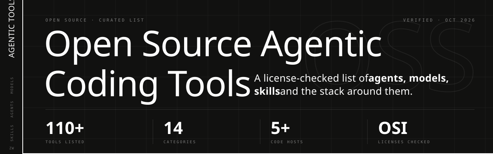

<p align="center">
  
</p>

<p align="center">
  <a href="https://github.com/johnmugabe"></a>
  <a href="https://www.linkedin.com/in/johnmugabejnr"></a>
  
  
  <a href="#contributing"></a>
</p>

<p align="center">
  <b>Find this list useful? <a href="https://github.com/johnmugabe">Follow me on GitHub</a> and ⭐ star this repository so others can find it too.</b>
</p>

# Open Source Agentic Coding Tools

A curated list of open source tools for agentic software development: models, agents, frameworks, automation, design, skills and the production stack around them. Every entry links to where its source code or downloadable weights live, whether that is GitHub, GitLab, Codeberg, SourceHut, Hugging Face, a package archive or a self-hosted forge.

The goal is a list you can trust at a glance: each entry states its license, tools that are only partly open are labeled, and closed tools are excluded.

> **Last verified:** 14 October 2026. Licenses and repository locations were checked against each project's repository or model card on that date. Projects move and relicense often, so confirm the license before you depend on a tool.

**How to read an entry**

- **Name** (linked to its source or download page): what it does. `License` · primary language or platform · host, when the source is not on GitHub.
- "Open weights" models publish their weights under the stated license; training data and pipelines are usually not released.

## Contents

1. [AI Models](#ai-models)
2. [Agent Frameworks and SDKs](#agent-frameworks-and-sdks)
3. [Coding Agents: Terminal and CLI](#coding-agents-terminal-and-cli)
4. [Coding Agents: Editors and IDEs](#coding-agents-editors-and-ides)
5. [Autonomous and Review Agents](#autonomous-and-review-agents)
6. [Automation and Workflows](#automation-and-workflows)
7. [Design and App Builders](#design-and-app-builders)
8. [Skills, Rules and Prompts](#skills-rules-and-prompts)
9. [Protocols and MCP Servers](#protocols-and-mcp-servers)
10. [Context and Codebase Tools](#context-and-codebase-tools)
11. [Production: Inference and Serving](#production-inference-and-serving)
12. [Production: Observability and Evaluation](#production-observability-and-evaluation)
13. [Sandboxes and Execution Environments](#sandboxes-and-execution-environments)
14. [Benchmarks and Datasets](#benchmarks-and-datasets)
15. [Source-Available and Restricted Licenses](#source-available-and-restricted-licenses)
16. [Archived Projects](#archived-projects)
17. [Excluded: Not Open Source](#excluded-not-open-source)
18. [A Note on Code Hosts](#a-note-on-code-hosts)
19. [Support This List](#support-this-list)
20. [Contributing](#contributing)

---

## AI Models

Open-weight language models tuned for code generation, tool use and long agent loops. Weights download from Hugging Face; models with use restrictions are listed under [Source-Available and Restricted Licenses](#source-available-and-restricted-licenses).

- **[Qwen3-Coder-480B-A35B-Instruct](https://huggingface.co/Qwen/Qwen3-Coder-480B-A35B-Instruct)**: Qwen's large mixture-of-experts coding model (480B total, 35B active) for agentic coding. `Apache-2.0` · Hugging Face
- **[Qwen3-Coder-Next](https://huggingface.co/Qwen/Qwen3-Coder-Next)**: Smaller (~80B) Qwen coding model built for agent workflows on modest hardware. `Apache-2.0` · Hugging Face
- **[GLM-5.2](https://huggingface.co/zai-org/GLM-5.2)**: Z.ai's ~750B model for long-horizon agentic coding and engineering tasks. `MIT` · Hugging Face
- **[GLM-5.3-Flash](https://huggingface.co/zai-org/GLM-5.3-Flash)**: Lighter ~320B multimodal member of the GLM-5.3 family, released August 2026. `MIT` · Hugging Face
- **[DeepSeek-V4-Pro](https://huggingface.co/deepseek-ai/DeepSeek-V4-Pro)**: DeepSeek's ~1.6T-parameter MoE model aimed at repository-level and agentic coding. `MIT` · Hugging Face
- **[LongCat-2.0](https://huggingface.co/meituan-longcat/LongCat-2.0)**: Meituan's ~1.8T-parameter MoE model targeting heavy agentic-coding workloads. `MIT` · Hugging Face
- **[gpt-oss-120b](https://huggingface.co/openai/gpt-oss-120b)** / **[gpt-oss-20b](https://huggingface.co/openai/gpt-oss-20b)**: OpenAI's open-weight reasoning models with native tool calling, common local agent backends. `Apache-2.0` · Hugging Face
- **[Devstral Small 2](https://huggingface.co/mistralai/Devstral-Small-2-24B-Instruct-2512)**: Mistral's 24B agentic coding model, small enough for a single high-end GPU. `Apache-2.0` · Hugging Face
- **[Laguna S 2.1](https://huggingface.co/poolside/Laguna-S-2.1)**: Poolside's ~118B coding model sized to run on a single 128 GB workstation. `OpenMDW-1.1` · Hugging Face
- **[Mellum 2.1](https://huggingface.co/JetBrains/Mellum2.1-12B-A2.5B-Thinking)**: JetBrains' 12B MoE (2.5B active) for completion, editing and agentic coding. `Apache-2.0` · Hugging Face
- **[OpenHands LM 32B](https://huggingface.co/OpenHands/openhands-lm-32b-v0.1)**: OpenHands' 32B model fine-tuned for software-engineering agent tasks. `MIT` · Hugging Face

## Agent Frameworks and SDKs

Libraries for building your own agents: planning loops, tool calling, memory, multi-agent orchestration and harnesses you can embed in products.

- **[LangGraph](https://github.com/langchain-ai/langgraph)**: Graph-based framework for stateful, long-running agents with checkpoints and human review. `MIT` · Python, JavaScript
- **[Deep Agents](https://github.com/langchain-ai/deepagents)**: LangChain's agent harness with planning, subagents and file tools, plus a terminal coding agent. `MIT` · Python, TypeScript
- **[CrewAI](https://github.com/crewAIInc/crewAI)**: Framework for role-based teams of autonomous agents that collaborate on tasks. `MIT` · Python
- **[Microsoft Agent Framework](https://github.com/microsoft/agent-framework)**: Microsoft's framework for agents and multi-agent workflows, succeeding AutoGen. `MIT` · Python, .NET
- **[AutoGen](https://github.com/microsoft/autogen)**: Microsoft's original multi-agent conversation framework; new projects are pointed to Agent Framework. `MIT` (code), `CC-BY-4.0` (docs) · Python
- **[smolagents](https://github.com/huggingface/smolagents)**: Hugging Face's minimal library for agents that write their actions as code. `Apache-2.0` · Python
- **[OpenAI Agents SDK](https://github.com/openai/openai-agents-python)**: Lightweight framework for multi-agent workflows with handoffs, guardrails and tracing. `MIT` · Python
- **[Pydantic AI](https://github.com/pydantic/pydantic-ai)**: Type-safe agent framework from the Pydantic team, with any-model support. `MIT` · Python
- **[Agent Development Kit (ADK)](https://github.com/google/adk-python)**: Google's code-first toolkit for building, evaluating and deploying agents. `Apache-2.0` · Python
- **[Mastra](https://github.com/mastra-ai/mastra)**: TypeScript framework for agents, workflows, memory and evals. `Apache-2.0` (`ee/` folders excluded) · TypeScript
- **[Letta](https://github.com/letta-ai/letta)**: Platform for stateful agents with persistent, self-editing long-term memory. `Apache-2.0` · Python
- **[Agno](https://github.com/agno-agi/agno)**: Framework and runtime for building and operating multi-agent systems. `Apache-2.0` · Python
- **[Koog](https://github.com/JetBrains/koog)**: JetBrains' framework for fault-tolerant agents on JVM, Android, iOS and the browser. `Apache-2.0` · Kotlin
- **[OpenHands Software Agent SDK](https://github.com/OpenHands/software-agent-sdk)**: Modular SDK behind OpenHands V1 for building custom coding agents. `MIT` · Python

## Coding Agents: Terminal and CLI

Agents that run in your terminal, read and edit the repository, run commands and tests, and work with the model of your choice.

- **[OpenCode](https://github.com/anomalyco/opencode)**: Provider-agnostic coding agent with a terminal UI, desktop app and local-model support. `MIT` · TypeScript
- **[Codex CLI](https://github.com/openai/codex)**: OpenAI's sandboxed terminal coding agent; also runs open models locally. `Apache-2.0` · Rust
- **[Gemini CLI](https://github.com/google-gemini/gemini-cli)**: Google's terminal agent for Gemini models with MCP support. `Apache-2.0` · TypeScript
- **[Qwen Code](https://github.com/QwenLM/qwen-code)**: Terminal coding agent adapted from Gemini CLI and tuned for Qwen models. `Apache-2.0` · TypeScript
- **[Kimi Code CLI](https://github.com/MoonshotAI/kimi-code)**: Moonshot AI's terminal coding agent, successor to the Python Kimi CLI. `MIT` · TypeScript
- **[Pi](https://github.com/earendil-works/pi)**: Minimal, extensible toolkit with a unified LLM API, agent loop, TUI and coding CLI. `MIT` · TypeScript
- **[goose](https://github.com/aaif-goose/goose)**: Extensible on-machine agent that installs, runs, edits and tests; now under the Agentic AI Foundation. `Apache-2.0` · Rust
- **[Aider](https://github.com/Aider-AI/aider)**: Git-aware pair programmer that edits files and commits changes from the terminal. `Apache-2.0` · Python
- **[Nanocoder](https://github.com/Nano-Collective/nanocoder)**: Community-built, local-first terminal agent that works with your own model. `MIT` · TypeScript
- **[Plandex](https://github.com/plandex-ai/plandex)**: Terminal agent for large, multi-file tasks with a reviewable change sandbox. `MIT` · Go
- **[Prime Agent](https://github.com/PrimeIntellect-ai/prime-agent)**: Self-improving agent for coding workflows and long-running autonomous tasks. `MIT` · Rust
- **[Warp](https://github.com/warpdotdev/warp)**: Agentic development environment built from the terminal; the client is open source. `AGPL-3.0` (UI crates `MIT`) · Rust

## Coding Agents: Editors and IDEs

Agents and assistants that live inside an editor, from VS Code and JetBrains extensions to Neovim and Emacs packages.

- **[Cline](https://github.com/cline/cline)**: VS Code coding agent that asks approval for each edit and command; also a CLI and SDK. `Apache-2.0` · TypeScript
- **[Kilo Code](https://github.com/Kilo-Org/kilocode)**: Agentic engineering platform for VS Code, JetBrains and the CLI. `MIT` · TypeScript
- **[Continue](https://github.com/continuedev/continue)**: Open-source coding agent for VS Code and JetBrains, plus a CLI for automation. `Apache-2.0` · TypeScript
- **[Zed](https://github.com/zed-industries/zed)**: High-performance editor with a built-in agent panel and external agent support. `GPL-3.0` (editor), `AGPL-3.0`, `Apache-2.0` (parts) · Rust
- **[Tabby](https://github.com/TabbyML/tabby)**: Self-hosted coding assistant server with IDE plugins and repository context. `Apache-2.0` (`ee/` folder excluded) · Rust
- **[avante.nvim](https://github.com/avante-corp/avante.nvim)**: Neovim plugin that brings Cursor-style AI editing and agent mode to Neovim. `Apache-2.0` · Lua
- **[CodeCompanion.nvim](https://github.com/olimorris/codecompanion.nvim)**: Neovim chat, inline edits and agents over many providers and Agent Client Protocol. `Apache-2.0` · Lua
- **[gptel](https://github.com/karthink/gptel)**: Simple, extensible LLM client for Emacs with tool use. [Download from NonGNU ELPA](https://elpa.nongnu.org/nongnu/gptel.html). `GPL-3.0` · Emacs Lisp
- **[Ellama](https://github.com/s-kostyaev/ellama)**: Emacs package for local and cloud LLMs, covering chat, code and review. [Download from GNU ELPA](https://elpa.gnu.org/packages/ellama.html). `GPL-3.0` · Emacs Lisp
- **[llm-agent](https://sr.ht/~berg/llm-agent/)**: Coding agent inside an Emacs buffer that reads files, runs commands and edits code. License: see repository · Emacs Lisp · SourceHut
- **[GitLab Language Server](https://gitlab.com/gitlab-org/editor-extensions/gitlab-lsp)**: Language server behind GitLab Duo editor extensions and the Duo CLI agent executor. `MIT` · TypeScript · GitLab

## Autonomous and Review Agents

Agents that take an issue or spec and work unattended, often in the background or in CI, and agents that review pull requests.

- **[OpenHands](https://github.com/OpenHands/OpenHands)**: Platform for running coding agents locally or at scale; enterprise governance is licensed separately. `MIT` · Python, TypeScript
- **[SWE-agent](https://github.com/SWE-agent/SWE-agent)**: Research agent that takes a GitHub issue and attempts a fix with your chosen model. `MIT` · Python
- **[mini-swe-agent](https://github.com/SWE-agent/mini-swe-agent)**: Roughly 100-line agent that solves GitHub issues with no heavy configuration. `MIT` · Python
- **[Open SWE](https://github.com/langchain-ai/open-swe)**: Asynchronous cloud coding agent and framework for building internal coding agents. `MIT` · Python
- **[Ralph Workflow](https://codeberg.org/RalphWorkflow/Ralph-Workflow)**: Orchestrator that runs Claude Code, Codex or OpenCode through plan, build, review and fix phases. `AGPL-3.0` · Python · Codeberg
- **[PR-Agent](https://github.com/The-PR-Agent/pr-agent)**: Open-source pull request reviewer for GitHub, GitLab and other forges. `MIT` · Python

## Automation and Workflows

Workflow engines, browser automation and CI integrations that trigger, schedule or host agent work.

- **[Activepieces](https://github.com/activepieces/activepieces)**: No-code workflow automation with AI agents and hundreds of MCP-ready integrations. `MIT` (`ee/` folders excluded) · TypeScript
- **[Windmill](https://github.com/windmill-labs/windmill)**: Developer platform that turns scripts into workflows, webhooks and internal UIs. `AGPL-3.0`/`Apache-2.0` (enterprise features excluded) · Rust
- **[Langflow](https://github.com/langflow-ai/langflow)**: Visual builder for AI agents and workflows that deploy as APIs. `MIT` · Python
- **[Node-RED](https://github.com/node-red/node-red)**: Low-code, flow-based programming tool for wiring event-driven automations and AI calls. `Apache-2.0` · JavaScript
- **[Temporal](https://github.com/temporalio/temporal)**: Durable-execution engine often used to run long, retry-safe agent jobs. `MIT` · Go
- **[Kestra](https://github.com/kestra-io/kestra)**: Event-driven orchestration and scheduling platform with AI-agent tasks. `Apache-2.0` · Java
- **[Prefect](https://github.com/PrefectHQ/prefect)**: Python workflow orchestration for resilient pipelines and scheduled jobs. `Apache-2.0` · Python
- **[Huginn](https://github.com/huginn/huginn)**: Self-hosted agents that monitor sources and act on your behalf. `MIT` · Ruby
- **[OpenClaw](https://github.com/openclaw/openclaw)**: General-purpose personal AI agent that runs on any OS; not coding-specific. `MIT` · TypeScript
- **[Browser Use](https://github.com/browser-use/browser-use)**: Library that lets agents drive a real browser for web tasks and testing. `MIT` · Python
- **[Stagehand](https://github.com/browserbase/stagehand)**: SDK for agents to act on and extract data from any website. `MIT` · TypeScript
- **[Codex GitHub Action](https://github.com/openai/codex-action)**: Runs Codex CLI inside GitHub Actions workflows for reviews, fixes and automation. `Apache-2.0` · JavaScript
- **[run-gemini-cli](https://github.com/google-github-actions/run-gemini-cli)**: GitHub Action that invokes Gemini CLI for issue triage, reviews and fixes. `Apache-2.0` · TypeScript

## Design and App Builders

Tools that turn prompts, sketches or screenshots into interfaces and apps, and design platforms agents can work with.

- **[Penpot](https://github.com/penpot/penpot)**: Open-source design and prototyping platform, self-hostable, with design-to-code workflows. `MPL-2.0` · Clojure
- **[Onlook](https://github.com/onlook-dev/onlook)**: Visual editor for designing and editing React apps in real code with AI. `Apache-2.0` · TypeScript
- **[screenshot-to-code](https://github.com/abi/screenshot-to-code)**: Converts screenshots and mockups into HTML, Tailwind, React or Vue code. `MIT` · Python
- **[OpenUI](https://github.com/wandb/openui)**: Describe a UI in words and see it rendered live, then export code. `Apache-2.0` · TypeScript
- **[Open Lovable](https://github.com/firecrawl/open-lovable)**: Clones and recreates websites as modern React apps from a URL. `MIT` · TypeScript
- **[Dyad](https://github.com/dyad-sh/dyad)**: Local AI app builder, an alternative to v0, Lovable and Bolt. `Apache-2.0` (`src/pro/` excluded) · TypeScript
- **[shadcn/ui](https://github.com/shadcn-ui/ui)**: Copy-in component library and registry that coding agents use to add UI. `MIT` · TypeScript
- **[CopilotKit](https://github.com/CopilotKit/CopilotKit)**: Frontend stack for in-app agents and generative UI; maintains the AG-UI protocol. `MIT` · TypeScript
- **[make-real-starter](https://github.com/tldraw/make-real-starter)**: Template that turns tldraw whiteboard sketches into working HTML. `AGPL-3.0` (tldraw SDK has its own license) · TypeScript

## Skills, Rules and Prompts

Reusable instructions that shape how coding agents work: skill packages, repository rule files and prompt collections.

- **[Agent Skills](https://github.com/agentskills/agentskills)**: Open specification for packaging agent skills as folders with a `SKILL.md`. `Apache-2.0` · Specification
- **[Superpowers](https://github.com/obra/superpowers)**: Skills library and development methodology for brainstorming, planning and subagent work. `MIT` · Markdown, Shell
- **[AGENTS.md](https://github.com/agentsmd/agents.md)**: Open format for repository instructions that guide coding agents. `MIT` · Specification
- **[awesome-cursorrules](https://github.com/PatrickJS/awesome-cursorrules)**: Collection of rule files that customize agent behavior per stack. `CC0-1.0` · Markdown
- **[llm-prompts](https://sr.ht/~jamesponddotco/llm-prompts/)**: Collection of prompts for coding, code review, writing and brainstorming. `CC0-1.0` · Markdown · SourceHut

## Protocols and MCP Servers

Open protocols that connect agents to tools and editors, plus widely used servers that implement them.

- **[Model Context Protocol](https://github.com/modelcontextprotocol/modelcontextprotocol)**: Specification for connecting AI applications to tools and data. `Apache-2.0` (moving from `MIT`) · Specification
- **[MCP reference servers](https://github.com/modelcontextprotocol/servers)**: Reference MCP servers for files, Git, fetch, memory and more. `Apache-2.0` (moving from `MIT`) · TypeScript, Python
- **[Agent Client Protocol](https://github.com/agentclientprotocol/agent-client-protocol)**: Protocol for connecting any editor to any coding agent. `Apache-2.0` · Rust, TypeScript
- **[GitHub MCP Server](https://github.com/github/github-mcp-server)**: GitHub's official MCP server for issues, pull requests, code and Actions. `MIT` · Go
- **[Playwright MCP](https://github.com/microsoft/playwright-mcp)**: MCP server that lets agents drive a browser through Playwright. `Apache-2.0` · TypeScript
- **[Serena](https://github.com/oraios/serena)**: MCP toolkit that gives agents semantic code search and editing through language servers. `GPL-3.0-or-later` (SolidLSP `MIT`) · Python
- **[Context7](https://github.com/upstash/context7)**: MCP server that pulls current library documentation into agent context via the Context7 service. `MIT` · TypeScript
- **[Forgejo MCP](https://git.b4mad.industries/agentic-forges/forgejo-mcp)**: MCP server for Forgejo instances; moved off Codeberg in July 2026. `GPL-3.0` · Go · Self-hosted Forgejo
- **[emcp](https://codeberg.org/martenlienen/emcp)**: MCP server that exposes a running Emacs to agents. `GPL-3.0` · Emacs Lisp · Codeberg

## Context and Codebase Tools

Utilities that pack, retrieve or pipe codebase context into models and agents.

- **[Repomix](https://github.com/yamadashy/repomix)**: Packs a whole repository into one AI-friendly file; also runs as an MCP server. `MIT` · TypeScript
- **[llmctx](https://sr.ht/~jamesponddotco/llmctx/)**: Small CLI that converts a directory into plain-text or XML context for LLMs. License: see repository · Go · SourceHut
- **[LLM](https://github.com/simonw/llm)**: Command-line tool and Python library for prompting models, with plugins and tool calling. `Apache-2.0` · Python

## Production: Inference and Serving

Engines and gateways for serving models to agents on your own hardware or behind a single API.

- **[Ollama](https://github.com/ollama/ollama)**: Simple local runner for open models, used by most CLI agents for offline work. `MIT` · Go
- **[llama.cpp](https://github.com/ggml-org/llama.cpp)**: Efficient LLM inference in C/C++ on CPUs and GPUs, with an OpenAI-compatible server. `MIT` · C++
- **[vLLM](https://github.com/vllm-project/vllm)**: High-throughput, memory-efficient serving engine for production model hosting. `Apache-2.0` · Python
- **[SGLang](https://github.com/sgl-project/sglang)**: Fast serving framework for language and multimodal models. `Apache-2.0` · Python
- **[llamafile](https://github.com/mozilla-ai/llamafile)**: Packages a model and runtime into one executable that runs anywhere. `Apache-2.0` · C++
- **[LiteLLM](https://github.com/BerriAI/litellm)**: Gateway that calls 100+ model APIs in one format with cost tracking and guardrails. `MIT` (`enterprise/` excluded) · Python, Rust

## Production: Observability and Evaluation

Tracing, cost tracking, testing and evaluation for agents running in production.

- **[Langfuse](https://github.com/langfuse/langfuse)**: Self-hostable tracing, evals and prompt management for LLM apps and agents. `MIT` (`ee/` folders excluded) · TypeScript
- **[OpenLLMetry](https://github.com/traceloop/openllmetry)**: OpenTelemetry instrumentation that traces LLM and agent calls into any observability backend. `Apache-2.0` · Python
- **[Helicone](https://github.com/Helicone/helicone)**: LLM observability with one-line setup for logging, cost and experiments. `Apache-2.0` · TypeScript
- **[Opik](https://github.com/comet-ml/opik)**: Tracing, automated evaluation and dashboards for LLM apps and agent workflows. `Apache-2.0` · Python, Java
- **[MLflow](https://github.com/mlflow/mlflow)**: AI engineering platform for tracing, evaluating and monitoring agents and models. `Apache-2.0` · Python
- **[promptfoo](https://github.com/promptfoo/promptfoo)**: Tests prompts and agents, compares models and runs red-team scans in CI. `MIT` · TypeScript

## Sandboxes and Execution Environments

Isolated environments where agents can run untrusted code, install packages and work in parallel safely.

- **[E2B](https://github.com/e2b-dev/E2B)**: Secure cloud sandboxes with real-world tools for running agent-generated code. `Apache-2.0` · Python, TypeScript
- **[Container Use](https://github.com/dagger/container-use)**: Gives each coding agent its own containerized environment and Git branch. `Apache-2.0` · Go
- **[Dagger](https://github.com/dagger/dagger)**: Programmable engine to build, test and ship code locally or in CI, usable by agents. `Apache-2.0` · Go

## Benchmarks and Datasets

Public benchmarks and datasets for measuring how well coding agents resolve real tasks.

- **[SWE-bench](https://github.com/SWE-bench/SWE-bench)**: Benchmark of real GitHub issues that agents must resolve; [Verified subset on Hugging Face](https://huggingface.co/datasets/princeton-nlp/SWE-bench_Verified). `MIT` · Python
- **[SWE-rebench](https://huggingface.co/datasets/nebius/SWE-rebench)**: Continuously refreshed dataset of software-engineering tasks for agent evaluation. `CC-BY-4.0` · Hugging Face
- **[Terminal-Bench](https://github.com/harbor-framework/terminal-bench)**: Benchmark of hard, realistic tasks agents must complete in a terminal. `Apache-2.0` · Python

## Source-Available and Restricted Licenses

These tools publish their source or weights, but the license is not an OSI-approved open source license or restricts some uses. They are listed here, separately, so they are not mistaken for fully open tools.

| Tool | Source | License | What is restricted |
| --- | --- | --- | --- |
| Crush | [GitHub](https://github.com/charmbracelet/crush) | `FSL-1.1-MIT` | Competing commercial use; each release converts to MIT after two years |
| GPT Pilot | [GitHub](https://github.com/Pythagora-io/gpt-pilot) | `FSL-1.1-MIT` | Competing commercial use; each release converts to MIT after two years |
| n8n | [GitHub](https://github.com/n8n-io/n8n) | Sustainable Use License | Limits commercial hosting; `.ee` files need an enterprise license |
| Dify | [GitHub](https://github.com/langgenius/dify) | Modified Apache-2.0 | No multi-tenant SaaS without permission; branding conditions |
| AutoGPT | [GitHub](https://github.com/Significant-Gravitas/AutoGPT) | Polyform Shield + MIT | `autogpt_platform` folder is under Polyform Shield; the rest is MIT |
| Arize Phoenix | [GitHub](https://github.com/Arize-ai/phoenix) | `Elastic-2.0` | No managed-service offering; license-key protections |
| GitLab AI Gateway | [GitLab](https://gitlab.com/gitlab-org/modelops/applied-ml/code-suggestions/ai-assist) | GitLab EE License | Production use requires a GitLab subscription |
| Anthropic Agent Skills | [GitHub](https://github.com/anthropics/skills) | `Apache-2.0` + source-available | `docx`, `pdf`, `pptx` and `xlsx` skills are source-available, not open source |
| Claude Agent SDK | [GitHub](https://github.com/anthropics/claude-agent-sdk-python) | `MIT` | SDK is open, but it drives the proprietary Claude Code runtime |
| Claude Code Action | [GitHub](https://github.com/anthropics/claude-code-action) | `MIT` | Action is open, but it runs the proprietary Claude Code CLI |
| Daytona | [GitHub](https://github.com/daytonaio/daytona) | `AGPL-3.0` (last public release) | Core moved to a private codebase in June 2026; public repo archived |
| Kimi K3 | [Hugging Face](https://huggingface.co/moonshotai/Kimi-K3) | Kimi K3 License | Modified MIT with conditions for large commercial deployments |
| GLM-5.3 | [Hugging Face](https://huggingface.co/zai-org/GLM-5.3) | Zhipu custom license | Custom terms; review before commercial use |
| Devstral 2 (123B) | [Hugging Face](https://huggingface.co/mistralai/Devstral-2-123B-Instruct-2512) | Custom license | Not Apache-2.0 like Devstral Small; review terms |
| StarCoder2 | [Hugging Face](https://huggingface.co/bigcode/starcoder2-15b) | BigCode OpenRAIL-M | Use-based restrictions carried into derivatives |
| Codestral | [Hugging Face](https://huggingface.co/mistralai/Codestral-22B-v0.1) | Mistral Non-Production License | Research and testing only; commercial use needs a separate license |

## Archived Projects

Open source projects that are now read-only. The code remains available to fork or study, but expect no fixes or releases.

- **[Roo Code](https://github.com/RooCodeInc/Roo-Code)**: Multi-agent coding extension for VS Code; last updated May 2026. `Apache-2.0` · TypeScript
- **[Void](https://github.com/voideditor/void)**: Open-source AI code editor built on VS Code; archived. `Apache-2.0` · TypeScript
- **[Flowise](https://github.com/FlowiseAI/Flowise)**: Visual builder for AI agents; last updated August 2026. `Apache-2.0` (enterprise folder excluded) · TypeScript
- **[GPT Engineer](https://github.com/AntonOsika/gpt-engineer)**: Early CLI for generating whole codebases from a prompt; precursor to Lovable. `MIT` · Python
- **[Refact](https://github.com/smallcloudai/refact)**: Self-hostable engineering agent with IDE plugins and on-prem fine-tuning; archived. `BSD-3-Clause` · Rust
- **[Kimi CLI (Python)](https://github.com/MoonshotAI/kimi-cli)**: Legacy Kimi terminal agent, replaced by Kimi Code CLI. `Apache-2.0` · Python
- **[OpenCode (Go)](https://github.com/opencode-ai/opencode)**: Original Go terminal agent named OpenCode; last updated September 2025. `MIT` · Go
- **[Copilot Chat for VS Code](https://github.com/microsoft/vscode-copilot-chat)**: Open-sourced Copilot Chat extension; last updated May 2026. `MIT` · TypeScript
- **[Penpot MCP](https://github.com/penpot/penpot-mcp)**: Standalone MCP server for Penpot; last updated March 2026. `MPL-2.0` · TypeScript

## Excluded: Not Open Source

The following popular agentic coding tools do not publish their source under an open license, so they are not listed above:

- **Claude Code**: its [public repository](https://github.com/anthropics/claude-code) holds documentation, plugins and issue tracking, with no license for the application source.
- **GitHub Copilot CLI**: its [repository](https://github.com/github/copilot-cli) ships under a proprietary license that allows running and redistributing unmodified copies only.
- **Cursor** and **Windsurf**: proprietary editors.

## A Note on Code Hosts

- **GitHub** hosts most of this ecosystem, which is why most links point there.
- **Hugging Face** is the main distribution point for open model weights and benchmark datasets.
- **GitLab** hosts GitLab's own Duo tooling, including the MIT-licensed language server and the source-available AI Gateway.
- **Codeberg** revised its terms in 2026 to prohibit "vibe-coded" projects: ones created autonomously by LLM agents, maintained with heavy LLM use, or using far more resources than a hand-built equivalent. Moderation is case by case, and existing projects are not being mass-deleted. Some agent projects, such as Forgejo MCP, have moved to self-hosted forges as a result. ([Codeberg blog](https://blog.codeberg.org/protecting-our-floss-commons-from-llms.html))
- **SourceHut** updated its terms, effective 10 September 2026 for new projects, to disallow original content produced with LLMs or other generative AI. A few LLM-related tools remain there, but expect little new agentic tooling. ([SourceHut blog](https://sourcehut.org/blog/2026-08-27-tos-changes-and-llms/))

## Support This List

Keeping this list accurate means re-checking licenses, repository moves and archived projects every month. If it helps you, here is how to help it grow:

- **Star this repository** to bookmark it and help other developers discover it.
- **[Follow @johnmugabe on GitHub](https://github.com/johnmugabe)** to hear about updates and new open source tools.
- **[Connect on LinkedIn](https://www.linkedin.com/in/johnmugabejnr)** for notes on agentic development and the tools that hold up in real projects.
- **Share it** with a teammate or community that is choosing agent tooling.
- **Suggest a tool or a correction** by opening an issue or pull request, as described below.

## Contributing

Suggestions are welcome. To add a tool, open a pull request with one line in the matching section that follows the existing format:

```markdown
- **[Tool name](https://link-to-source-or-download)**: One-sentence description of what it does. `SPDX-License` · Language or platform · Host (if not GitHub)
```

Inclusion criteria:

1. The tool is used to build, run, extend or evaluate AI agents for software work.
2. Its source code or model weights are publicly downloadable.
3. Its license is OSI-approved open source. Source-available tools go in the [restricted licenses](#source-available-and-restricted-licenses) table with the restriction stated.
4. It is maintained, or it is listed under [Archived Projects](#archived-projects).

## License

This list is dedicated to the public domain under [CC0 1.0](https://creativecommons.org/publicdomain/zero/1.0/). Each listed project is governed by its own license.

<p align="center">
  Maintained by <a href="https://github.com/johnmugabe">John Mugabe</a> ·
  <a href="https://github.com/johnmugabe">GitHub</a> ·
  <a href="https://www.linkedin.com/in/johnmugabejnr">LinkedIn</a>
  <br>
  <sub>If this list helped you, a ⭐ star or a follow keeps it going.</sub>
</p>
